<div align="center">


# Gota Poblana

### Hacemos que el cloro funcione.

Monitoreo y control del pH del agua con un ESP32-S3 y una app Flutter.<br/>
Mide, decide y dosifica, sin internet.


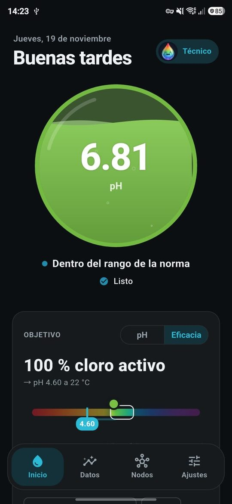
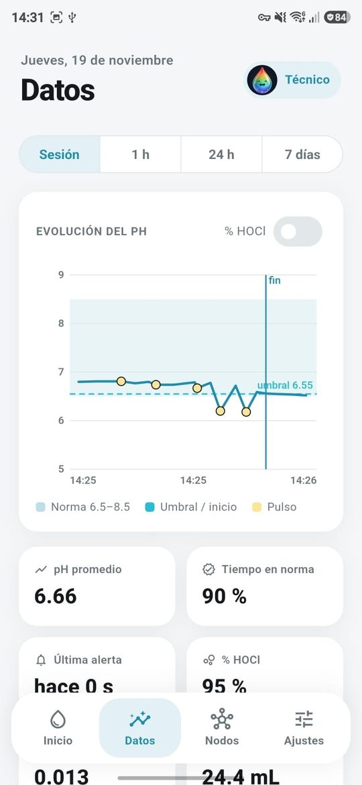
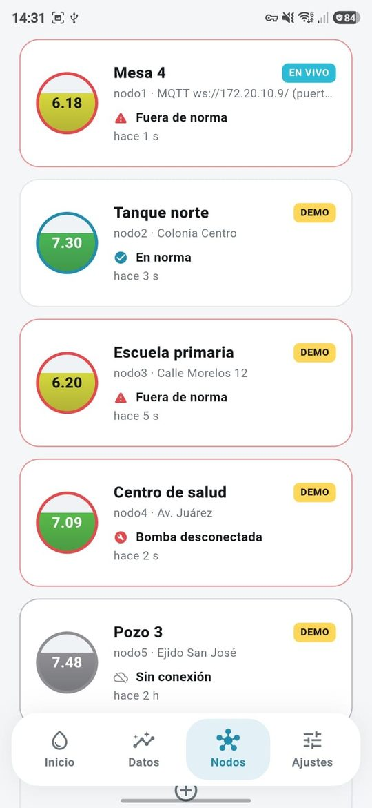
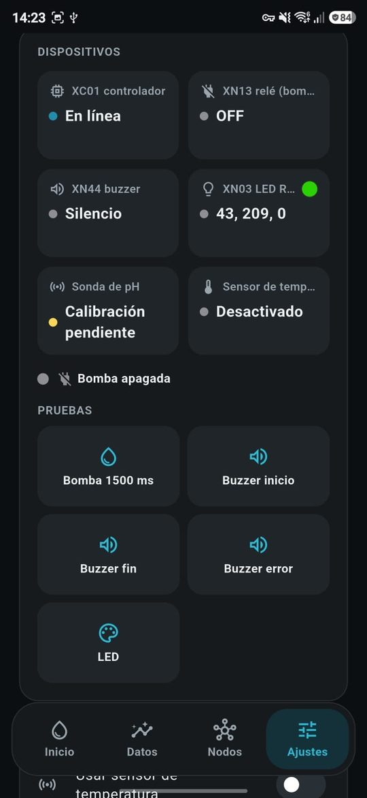

**Equipo Pulse** · Jesus · Gabriel · Melanie · Rosh

</div>

---

## Contenido

- [El problema en 30 segundos](#el-problema-en-30-segundos)
- [Cómo funciona](#cómo-funciona)
- [La app](#la-app)
- [El equipo (hardware)](#el-equipo-hardware)
- [Control adaptativo](#control-adaptativo-pulso-espera-aprende)
- [Seguridad](#seguridad)
- [Inicio rápido](#inicio-rápido)
- [Arquitectura del código](#arquitectura-del-código)
- [Contrato app ↔ firmware](#contrato-app--firmware)
- [Pruebas](#pruebas)
- [Configuración: dónde editar](#configuración-dónde-editar)
- [Transparencia](#transparencia)
- [Lo que sigue](#lo-que-sigue)

---

## El problema en 30 segundos

**Mismo cloro. Dos tanques. La diferencia es el pH.**

| | pH 6.5 | pH 7.5 | pH 9.0 |
|---|:---:|:---:|:---:|
| Cloro que **desinfecta** (HOCl, 25 °C) | **92 %** | **52 %** | **3 %** |

El cloro libre en el agua existe en dos formas: el **ácido hipocloroso (HOCl)**, que
desinfecta, y el **hipoclorito (OCl⁻)**, decenas de veces menos eficaz. El pH decide
cuánto hay de cada uno:

$$
\alpha_{\mathrm{HOCl}} \;=\; \frac{1}{1 + 10^{\,\mathrm{pH} - \mathrm{p}K_a(T)}}
\qquad\qquad
\mathrm{p}K_a(T) \;=\; \frac{3000}{T} - 10.0686 + 0.0253\,T
$$

con $T$ en kelvin ($\mathrm{p}K_a \approx 7.54$ a 25 °C). Bajar el pH hace que el
**mismo cloro rinda más**. Pero no todo vale: por debajo de 6.5 el agua corroe
tuberías y puede liberar cloro gas. La norma mexicana **NOM-127-SSA1-2021** pide
**pH entre 6.5 y 8.5**.

<p align="center">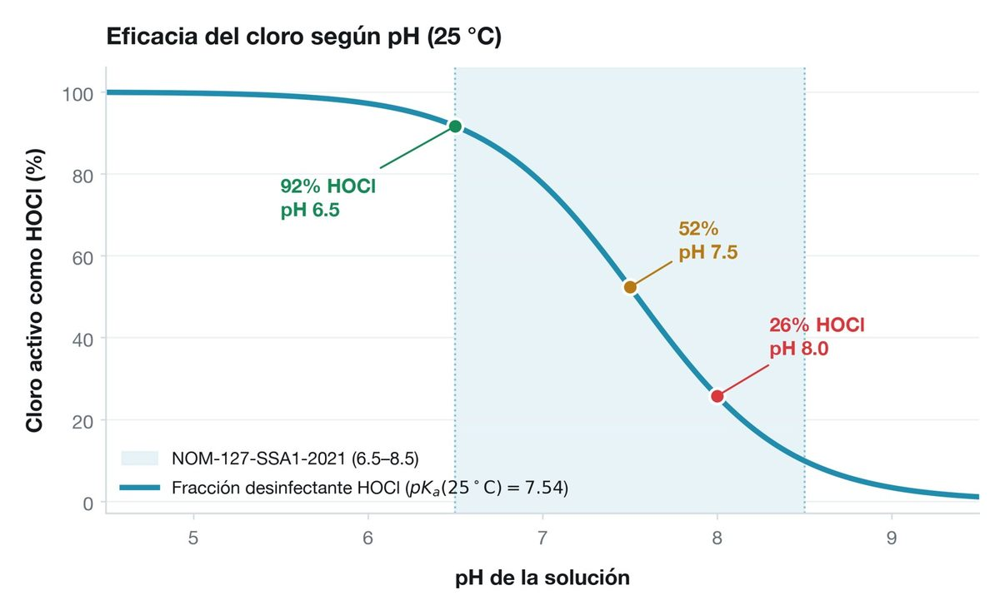</p>

**El reto:** solo se puede **añadir ácido**. Pasarse no tiene vuelta atrás, la mezcla
tarda y cada agua responde distinto a cada mililitro. Por eso Gota Poblana no
dosifica "a ciegas": da pulsos pequeños, espera, mide y aprende.

---

## Cómo funciona

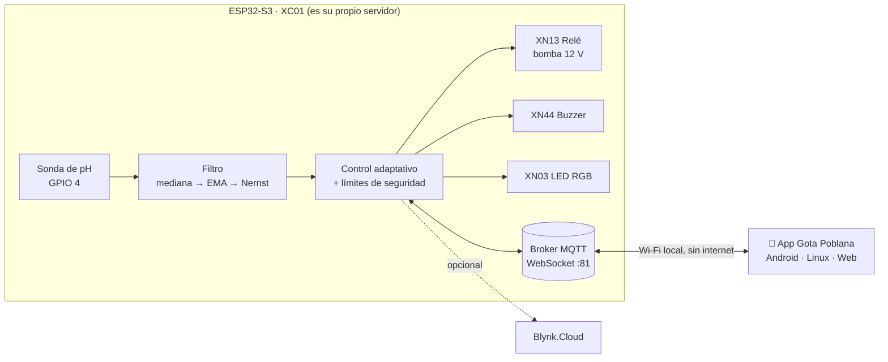

1. **El ESP32 mide** el pH (4 lecturas por segundo, filtradas) y lo publica por MQTT.
2. **La app lo muestra** a cualquiera, en lenguaje claro, y avisa si algo sale de norma.
3. **El técnico pide** un objetivo (pH o % de cloro activo). La app envía **siempre un umbral de pH**.
4. **El ESP32 decide y protege**: dosifica en pulsos, valida cada orden y puede rechazarla.

> La app **nunca toca el hardware**. Solo envía órdenes de alto nivel y refleja lo que el equipo reporta.

---

## La app

**Clara para todos. Precisa para el técnico.** Una sola app con dos roles, que se eligen en
la introducción (menos de 50 s, con *Omitir*) y se cambian en Ajustes.

<table>
<tr>
<td align="center" width="25%"><br/><b>La pecera</b><br/><sub>El agua toma el color del pH, como el papel indicador. Olas y burbujas animadas.</sub></td>
<td align="center" width="25%">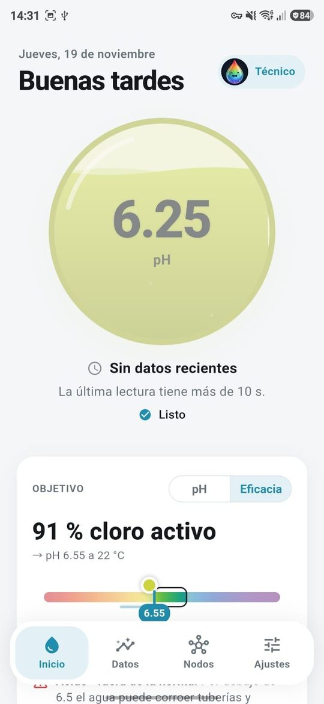<br/><b>Objetivo en la escala</b><br/><sub>La escala de pH es el control: se arrastra el objetivo (4.5–7.0). Modo eficacia: "91 % de cloro activo" → pH 6.55.</sub></td>
<td align="center" width="25%"><br/><b>Datos</b><br/><sub>Gráfico con la banda de la norma, umbral, pulsos, % HOCl, sesiones y exportar CSV.</sub></td>
<td align="center" width="25%"><br/><b>Cada módulo, en vivo</b><br/><sub>Estado del kit, pruebas seguras de bomba, buzzer y LED, y calibración.</sub></td>
</tr>
</table>

| 👤 Ciudadano (solo lectura) | 🛠️ Técnico |
|---|---|
| Pecera con el pH en vivo y su color | Todo lo del ciudadano |
| "Dentro del rango de la norma" / "Fuera de rango" | Objetivo por **pH** o por **% de cloro activo** |
| Escala de pH que explica qué es peligroso | Dosificar (con confirmación) y **Detener**, siempre visible |
| "El cloro trabaja al 83 %" | Panel **Dispositivos**: XC01, XN13, XN44, XN03, sondas |
| Historial 24 h / 7 días | **Test de hardware** paso a paso, estilo arranque de Linux |
| Avisos fuera de norma | Calibración de sonda y de **caudal de la bomba** (2 puntos) |
| | Registro de eventos, sesiones, conexión MQTT |

**Detalles que importan**

- 🚨 **Si el equipo reporta una falla**, la pecera se pone roja y dice *"Hacer test de errores"*. Al tocarla, la app revisa conexión, lecturas, sonda, relé, buzzer, LED, ácido y calibración, línea por línea.
- 🔔 **Notificaciones del sistema** con la app en segundo plano (Android y Linux): inicio, fin, fallas, fuera de norma y pérdida de conexión, con sonido de dos tonos ascendentes, tres descendentes o tres graves.
- 🌗 **Modo claro, oscuro o del sistema**, diseño para teléfono vertical, horizontal, tablet y escritorio, y respeto al *movimiento reducido*.
- 🕸️ **Vista de red (Nodos)**: el nodo real en vivo y, por ahora, cuatro nodos de demostración.
- 🧪 **Simulador integrado** que imita al firmware regla por regla: se puede hacer la demo completa sin hardware.

<p align="center">
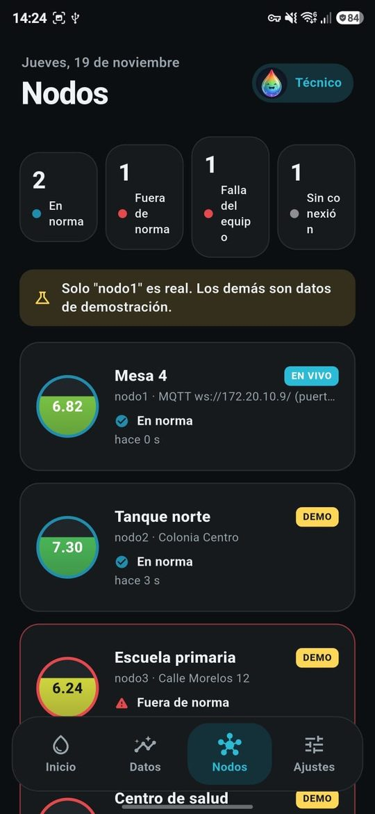

</p>

---

## El equipo (hardware)

**Plataforma XIDE de Microside.** Un ESP32-S3 que es su propio servidor: el teléfono se conecta directo, sin internet.

<p align="center">
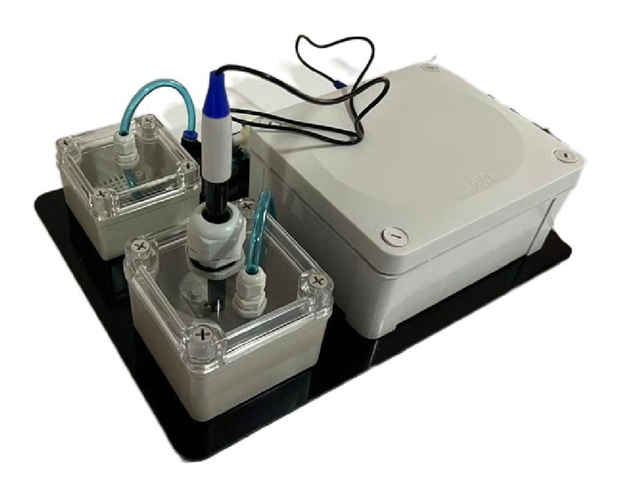
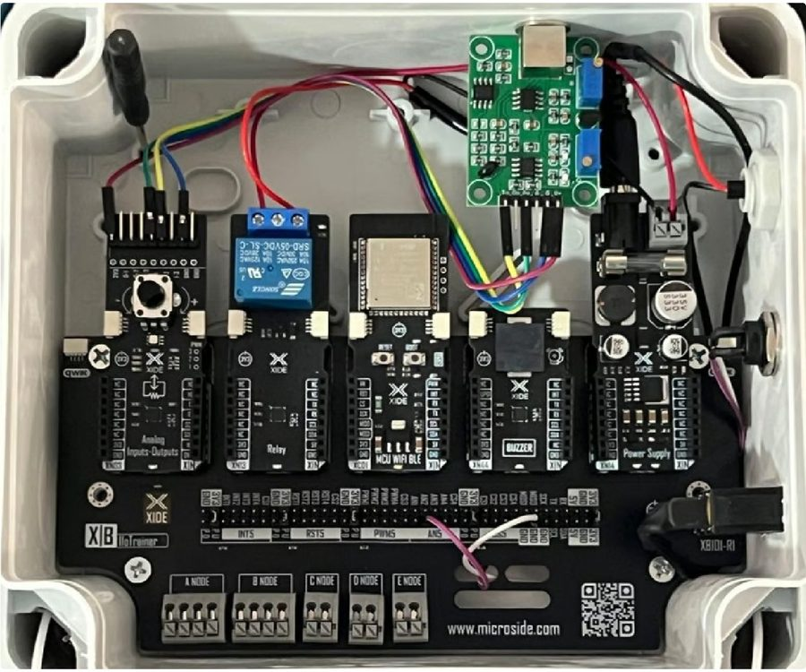
</p>

| Módulo | Función | Bus / pin |
|---|---|---|
| **XC01** ESP32-S3 | Mide, filtra, controla y es el broker MQTT | Zócalo 5 de la XBI01 |
| **Sonda de pH** | Lectura analógica | AN = GPIO 4 |
| **XN03** E/S analógicas | LED RGB de estado | I²C `0x03` |
| **XN13** Relé | Bomba de 12 V | I²C `0x0D` (reg `0x01`: `0x01` ON / `0x00` OFF) |
| **XN44** Buzzer | Tonos de inicio, fin y error | I²C `0x2C` |
| **XN14** Fuente | 7–24 V → 3.3 V / 5 V | — |
| Pantalla SH1106 | IP y estado en el equipo | I²C |

Bus I²C: SDA = GPIO 12, SCL = GPIO 13. Serial USB a 115200 baudios.

**Medición:** mediana de 5 → filtro exponencial (α = 0.15) → conversión con compensación de **Nernst** por temperatura. El ruido medido en mesa es de **0.006 pH pico a pico**.

<p align="center">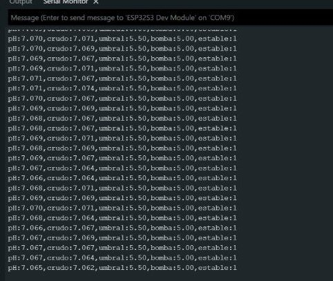</p>

---

## Control adaptativo: pulso, espera, aprende

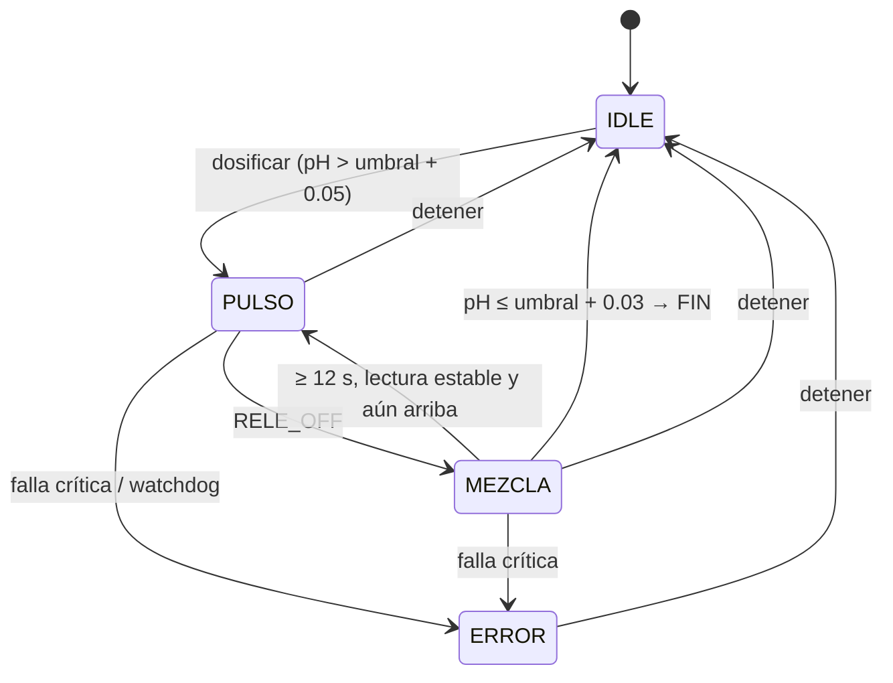

1. **Un pulso pequeño** de ácido.
2. **Espera** al menos 12 s y hasta que la lectura sea estable: pendiente menor a 0.005 pH por muestra durante 3 s, con un máximo de 60 s.
3. **Aprende** cuánto bajó el pH por mL ($\hat{s}$) y calcula el siguiente pulso con solo una fracción de lo que falta:

$$
V_{\text{siguiente}} \;=\; \operatorname{clamp}\!\left(\gamma \cdot \frac{\mathrm{pH} - \mathrm{umbral}}{\hat{s}},\; V_{\min},\; 3\ \mathrm{mL}\right),
\qquad
\gamma = \begin{cases} 0.40 & \text{lejos} \\ 0.25 & \text{a menos de 0.3 pH} \end{cases}
$$

La bomba se modela como $V = q\,(t - t_0)$, con caudal $q$ y tiempo de arranque
$t_0$, que se calibran desde la app con dos pulsos medidos en probeta (500 y 1500 ms).

<p align="center">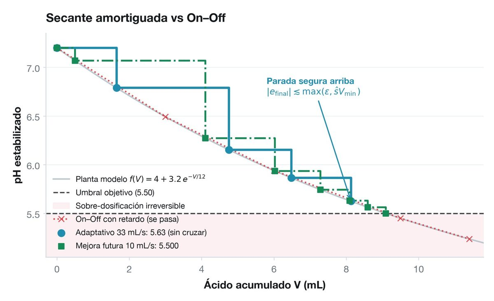</p>

**¿Por qué no on-off ni PID?**

| | Qué pasa |
|---|---|
| **On-off** | Se pasa por el retardo de mezcla: a 33 mL/s, cada segundo de más son 33 mL. |
| **PID** | Acumula error durante la espera y supone que puede corregir en ambos sentidos, pero aquí no se puede subir el pH. |
| **Gota Poblana** | Es más lento a propósito: aprende la respuesta del agua en cada pulso y se detiene antes de cruzar el umbral. |

---

## Seguridad

**La seguridad vive en el equipo.** La app supervisa, pero no puede saltarse los límites.

| Límite | Valor |
|---|---|
| Pulso máximo | **1.5 s**; un vigilante independiente corta a **1.65 s** |
| Por paso / por sesión | **3 mL** / **95 mL**, con inventario de ácido |
| Umbral permitido | **4.5 – 7.0** (solo se puede bajar el pH) |
| Rechazo | `dosificar` si el pH ya está a ≤ umbral + 0.05 |
| Fallas críticas | Sonda, relé, bus I²C, ácido agotado → bomba apagada y estado `ERROR` |
| Internet | **No se necesita.** Si cae el Wi-Fi, la sesión termina sola. |
| En la app | Bomba solo en rol técnico, con confirmación, "Enviando…" hasta que el equipo responde y *"Sin respuesta del dispositivo"* a los 3 s |

---

## Inicio rápido

### App (Flutter)

```bash
cd app
flutter pub get
flutter test                             # cálculos, simulador, avisos, diagnóstico
flutter run -d linux                     # escritorio
flutter run -d <id-del-teléfono>         # Android (ver: flutter devices)
flutter run -d web-server --web-port 8080
```

> 💡 **Sin hardware:** entra como **Técnico** → Ajustes → Conexión → **Simulador**. Todo funciona igual, con la etiqueta *MODO SIMULADO*.

### Firmware (PlatformIO)

```bash
cd firmware
pio run -t upload          # compila y sube al ESP32-S3
pio device monitor         # 115200 baudios: imprime la IP y el broker
```

1. Configura el Wi-Fi en `firmware/src/main.cpp`. Por defecto se conecta al hotspot del equipo.
2. Conecta el teléfono a la **misma red**.
3. En la app: Ajustes → Conexión → **ESP32 (MQTT)**, con host = la IP que imprime el equipo, puerto **81** y ruta **/**.

> 📶 **Sin red WiFi:** si el ESP32 no encuentra el hotspot en 20 s, abre su propia red
> **`ESP32S3-Sensor`** (clave `12345678`). Conecta el teléfono a esa red: la app prueba
> sola `192.168.4.1:81` y se conecta sin tocar nada.

Para usarlo sin Blynk, pon `#define USE_BLYNK 0`.

---

## Arquitectura del código

```
CloracionAgua/
├── app/                         App Flutter (Android · Linux · Web)
│   ├── lib/
│   │   ├── core/                Puro Dart, sin Flutter: química, colores, constantes del contrato
│   │   │   ├── chem.dart          pKa(T), % HOCl, pH recomendado, NOM-127
│   │   │   ├── caudal.dart        calibración de bomba V = q·(t − t0)
│   │   │   ├── device_constants.dart  temas, comandos, límites, tonos
│   │   │   └── ph_colors.dart     tabla del indicador universal (15 colores)
│   │   ├── data/                Servicio de dispositivos (interfaz única)
│   │   │   ├── data_source.dart   DataSource + Cmd
│   │   │   ├── simulador_esp32.dart  imita al firmware regla por regla
│   │   │   ├── mqtt_source.dart   cliente MQTT/WebSocket
│   │   │   └── models.dart        Telemetria, EventoDispositivo, HardwareEstado, FallaHw
│   │   ├── state/               AppState (roles, historial, avisos, diagnóstico)
│   │   ├── services/            sonidos, notificaciones del sistema
│   │   └── ui/                  Inicio, Datos, Nodos, Ajustes, onboarding, tokens claro/oscuro
│   └── test/                    pruebas unitarias y de integración con el simulador
├── firmware/                    PlatformIO · ESP32-S3
│   ├── src/main.cpp               medición, control, broker MQTT, HTTP, Blynk, OLED
│   ├── src/agua_contrato.h        nombres compartidos con la app
│   └── CONTRATO.md                el contrato explicado para el firmware
└── docs/img/                    imágenes de este README
```

**Principio:** UI → `AppState` → `DataSource`. El simulador y MQTT son intercambiables, y la UI nunca sabe de dónde vienen los datos.

---

## Contrato app ↔ firmware

Todo viaja por MQTT sobre WebSocket, en temas `agua/<nodo>/…`. Los nombres viven en
[`firmware/src/agua_contrato.h`](firmware/src/agua_contrato.h) y en
[`app/lib/core/device_constants.dart`](app/lib/core/device_constants.dart). El detalle completo,
con ejemplos y código, está en [**firmware/CONTRATO.md**](firmware/CONTRATO.md).

| Tema | Dirección | Contenido |
|---|---|---|
| `agua/nodo1/ph` | ESP → app | `6.84` |
| `agua/nodo1/estado` | ESP → app | `IDLE` · `PULSO` · `MEZCLA` · `ERROR` |
| `agua/nodo1/telemetria` | ESP → app | JSON: `ph`, `mv`, `umbral`, `acido_restante_ml`, `s_hat`, `resumen`, `caudal_ml_s`… |
| `agua/nodo1/evento` | ESP → app | `{"tipo":"RECHAZO","detalle":"…","cmd":"p 2000"}` (sin retain) |
| `agua/nodo1/hardware` | ESP → app | `rele`, `led`, `buzzer`, `sensor`, `modulos`, `fallas[]` |
| `agua/nodo1/umbral` | app → ESP | `6.60` |
| `agua/nodo1/cmd` | app → ESP | `dosificar` · `detener` · `p <ms>` · `c <pH>` · `a 100` · `q <mL/s> <t0>` · `test_buzzer <x>` · `test_led r g b` |

Toda orden se responde con un **evento que incluye `cmd`**: así la app sabe a qué orden
responde y quita su *"Enviando…"*.

---

## Pruebas

```bash
cd app && flutter test
```

| Archivo | Qué garantiza |
|---|---|
| `chem_test.dart` | A 25 °C: pH 7.0 → 77.5 % HOCl, pH 8.0 → 25.6 %, 90 % → pH 6.58. Temperatura, NOM-127 y colores |
| `simulador_test.dart` | Las reglas del firmware: rechazos, pulsos, retardo de red, fallas y caudal |
| `caudal_test.dart` | La calibración de 2 puntos recupera $q$ y $t_0$ |
| `avisos_test.dart` | Cada evento produce su aviso y su sonido; se respeta el interruptor de "Sonidos" |
| `diagnostico_test.dart` | El test de hardware completo contra el simulador |
| `models_test.dart` | Parseo del JSON del contrato |

---

## Configuración: dónde editar

| Qué | Dónde |
|---|---|
| Temas MQTT, comandos, tonos, pulso máximo, MQTT activo | `app/lib/core/device_constants.dart` |
| Host / puerto / ruta / nodo | En la app: Ajustes → Conexión (técnico) |
| Tabla de colores del indicador universal | `app/lib/core/ph_colors.dart` |
| Colores claro/oscuro y espaciado | `app/lib/ui/tokens.dart` |
| Tiempo de mezcla, γ, tope por pulso | `firmware/src/agua_contrato.h` (`MEZCLA_MS`) y `firmware/src/main.cpp` (`gammaCtl`, `gammaCerca`, `volMaxPaso`) |
| Wi-Fi / Blynk | `firmware/src/main.cpp` |

---

## Transparencia

**Nunca decimos "agua segura".** Solo medimos pH, y por eso lo decimos claro.

| | |
|---|---|
| ✅ **Real** | Sonda, filtrado, control, bomba, buzzer, LED, MQTT y Blynk |
| 🧮 **Calculado** | % de HOCl, a partir del pH real y la temperatura |
| 🌡️ **Supuesto** | Temperatura: 22 °C capturada, no medida (sin sensor) |
| 🎭 **Demostración** | Los otros nodos de la vista de red |

---

## Lo que sigue

**Del banco de pruebas a un tanque real.**

1. ➕ **Cloro libre:** sensores de cloro y de temperatura.
2. → **HOCl real**, medido en mg/L y no solo calculado.
3. → **Cloro + pH dosificados juntos**, con LTE para pozos sin red.

---

<div align="center">


**No solo cloramos el agua. Hacemos que el cloro funcione.**

Gota Poblana · Equipo Pulse · Hackatón Puebla 2026 · Reto Agua Microside

</div>
